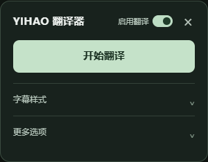
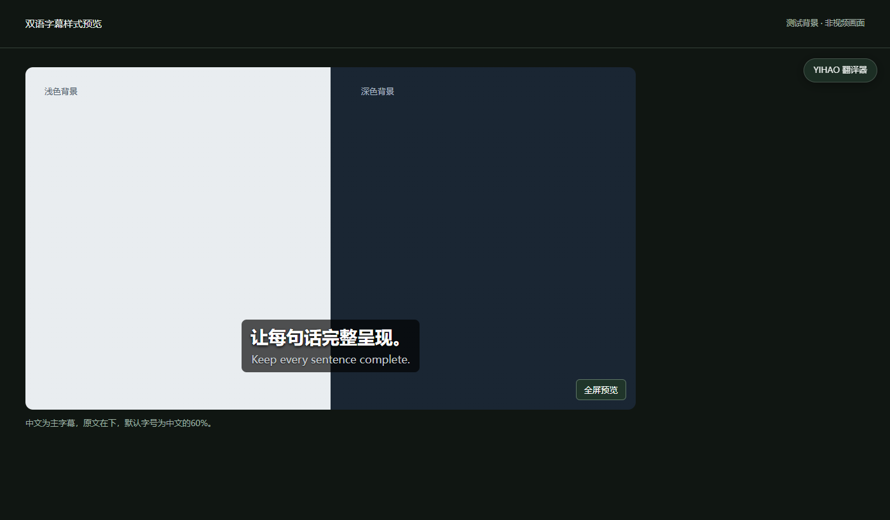

# YIHAO 翻译器

**YouTube 整句双语字幕 · 让每句话完整呈现。**

在YouTube页面内，把原语言字幕翻译成便于阅读的中文或双语字幕。主界面只有一个核心操作：**开始翻译**。

**0.1.4 测试版 · Chrome 116+ · 使用自己的DeepSeek API Key · 无需安装exe、Python或运行服务器**

> 当前已验证“导入原字幕 → 浏览器内翻译 → 整句显示”。自动获取网页字幕在隔离测试环境中未通过，还需要在日常登录的Chrome中验证。登录不保证所有视频都能获取字幕。想先安装试用，请按下面的教程操作。

## 第一次使用，从这里开始

1. 打开本仓库右侧的 **Releases（版本发布）**，下载 `YIHAO-Translator-v0.1.4.zip`。初次试用优先下载这个安装包，不要选下面自动生成的“Source code”。
2. 右键ZIP，选择“全部解压”。打开解压后的文件夹，应当**直接看到 `manifest.json`**。
3. 在Chrome地址栏输入 `chrome://extensions`，开启“开发者模式”，点击“加载已解压的扩展程序”，选择这层文件夹。
4. 打开一个普通YouTube视频并刷新页面，点击右侧“YIHAO 翻译器”，再点击“开始翻译”。首次会引导你配置自己的DeepSeek密钥。
5. 保存后回到视频，再点击“开始翻译”。先预读全文，再分批显示整句字幕。

如果仓库还没有Releases，可以点绿色 **Code → Download ZIP** 下载源码。解压后继续打开，直到找到直接包含 `manifest.json` 的文件夹，再加载这一层；不需要运行任何代码。

**需要逐步教你点哪里？**

- [安装与首次使用](docs/INSTALL.md)
- [注册、配置DeepSeek密钥](docs/API_KEY.md)
- [遇到问题怎么办](docs/FAQ.md)
- [已有用户怎么更新](docs/UPDATE.md)

安装后，Chrome工具栏上的扩展图标在YouTube中可开关面板；在其他页面点击会打开离线教程。也可以在扩展管理页的“详细信息 → 扩展程序选项”打开首次设置。

## 暂停整个插件：启用翻译

主面板标题旁的“启用翻译”总开关默认开启。关闭后，插件会隐藏自定义字幕、恢复YouTube原生字幕，并阻止新的翻译任务。已经发出的API请求会完成并缓存结果，之后不再继续后续批次；已产生的调用仍可能计费。

开关状态会同步到已经打开的YouTube页面，并在刷新页面、重启浏览器后记住。重新开启时会恢复已生成字幕；未完成的付费翻译需要你点击“继续翻译”，不会自动恢复。密钥、字幕样式和缓存均保留。

“字幕样式”里的“显示字幕”只隐藏或显示字幕，**不会停止翻译**。想暂停翻译，请关闭标题旁的总开关。

## 默认效果与样式调整

- 中文在上：默认28px、半粗白字、柔和黑色投影。
- 原文在下：默认中文字号的60%（16.8px），较轻的字重和投影。
- 两行共用的暗色背景默认开启，可在“字幕样式”中关闭，保留文字投影。
- 点击“调整字幕样式”，分别设置中文和原文的字号、颜色、加粗和投影。原文用百分比跟随主字幕，默认60%。
- 语言选择和字幕下载在“更多选项”中；日常面板不显示密钥设置与原字幕导入。

上图使用自制亮暗背景演示样式，非真实视频画面。

## 当前可以做什么

| 功能 | 状态 |
|---|---|
| 在YouTube页面内操作，中文／双语显示 | 已验证 |
| “启用翻译”总开关、跨页面同步、记住开关状态 | 已实现；关闭后暂停后续批次，保留缓存 |
| 完整句意分组、句末标点、术语预读 | 已实现；语义和专业准确性仍需抽查 |
| 独立字幕样式、背景开关、全屏显示 | 已实现并做界面检查 |
| 下载中文或双语SRT | 已实现；未处理完时下载的是已完成部分 |
| 导入原语言SRT／VTT／JSON3 | 设置页“高级排错”中使用 |
| 自动获取YouTube原字幕 | 仍在验证，可能被会话、限制或改版影响 |
| 无字幕视频的语音识别、直播、Shorts、画中画 | 暂未支持或完成验证 |

没有原语言字幕时，当前版本不能直接靠听声音翻译。SRT／VTT没有完整逐词信息，句内时间属于估算；本项目尚未做音频强制对齐。

## 费用与数据

插件本地安装不收费；**DeepSeek API按实际调用量计费**，以[官方定价](https://api-docs.deepseek.com/quick_start/pricing/)和账户账单为准。每位用户配置自己的密钥，本项目不提供共享密钥或充值服务。

密钥只保存在当前浏览器的扩展本地存储中，仅随请求发往DeepSeek官方API。待翻译字幕与视频标题、频道、时长、视频ID等相关信息会发送给DeepSeek；译文和进度缓存保留在浏览器。具体见[隐私与权限说明](docs/PRIVACY.md)。

## 给上传这个项目的人

你不需要先学Git命令。按照 [网页上传GitHub与发布安装包](docs/PUBLISH_GITHUB.md) 操作即可。源码文件放仓库首页；普通用户安装ZIP放Releases附件。

源码目录本身也可以直接加载，因为根目录就有 `manifest.json`。`scripts/` 和 `tests/` 只供维护者检查、打包，普通用户不用运行。详见[维护与开发说明](docs/DEVELOPMENT.md)。

## 使用范围与许可

目前只公开源码，**暂未指定开源许可证**，未授予额外的修改、再分发或商用许可。平台规则或法律允许的行为不受此说明影响。详见 [NOTICE.md](NOTICE.md)。

本项目与YouTube、Google、DeepSeek没有官方关联。反馈问题请在仓库 **Issues → New issue** 填表，勿上传密钥或账户资料。
