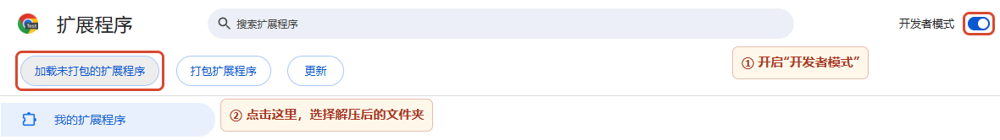
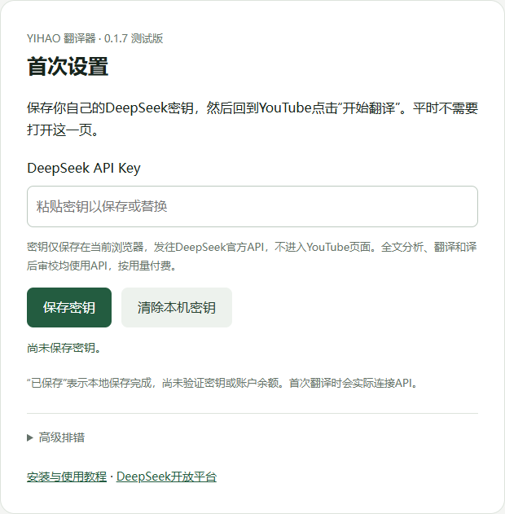

# [⬇ 下载 YIHAO 翻译器（ZIP）](https://github.com/chenyihao009/yihao-translator-/archive/refs/heads/main.zip)

YouTube 整句双语字幕。下载解压后即可加载，无需编译。

需要 **电脑版 Chrome 116+** 和自己的 **DeepSeek API Key**，API 按用量付费。

## ① 下载并解压

点击上面的下载链接，右键 ZIP 选择“全部解压”。打开解压后的文件夹，找到直接包含 `manifest.json` 的那一层。

## ② 加载到 Chrome

地址栏输入 `chrome://extensions` → 开启右上角“开发者模式” → 点击左上角“加载…”按钮，选择第①步的文件夹。

## ③ 保存自己的密钥

打开 YouTube 视频并刷新，点击右侧 **YIHAO 翻译器 → 开始翻译**。首次会打开下图，填入自己的 DeepSeek 密钥，点击“保存密钥”。[不会创建密钥？点这里](docs/API_KEY.md)

## ④ 回到视频，开始翻译

回到视频点击 **开始翻译**，等待预读、翻译和自动审校（均按 API 用量计费）。暂时不用时，关闭标题旁的 **启用翻译**；字号和背景在“字幕样式”里调整。

测试版：自动获取字幕仍在验证，失败时可[导入原字幕](docs/INSTALL.md#自动获取失败时导入对应字幕)；无字幕视频暂不支持。

[常见问题](docs/FAQ.md) · [更新方法](docs/UPDATE.md) · [隐私说明](docs/PRIVACY.md) · [许可状态](NOTICE.md)
