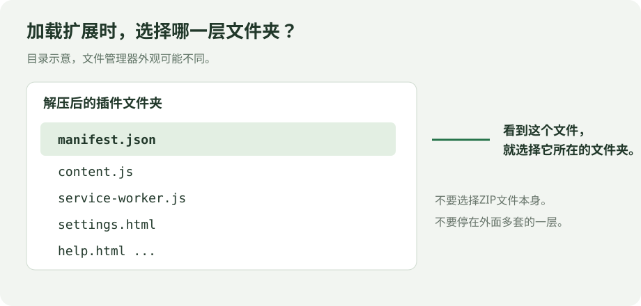
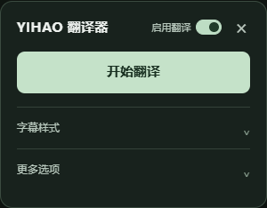
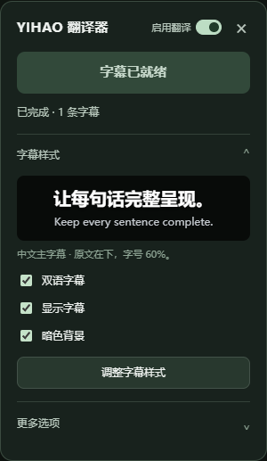

# 安装与第一次使用

[返回首页](../README.md) · [配置 DeepSeek 密钥](API_KEY.md) · [常见问题](FAQ.md)

本教程适用于 **0.1.5 测试版**。你只需要 Chrome、能正常打开的 YouTube 视频，以及自己的 DeepSeek API 密钥。不需要安装 exe、Python、Node.js，也不需要运行命令。

目前已验证“导入原字幕 → 浏览器内调用 DeepSeek → 显示整句字幕”。自动获取 YouTube 字幕仍需在你的日常浏览器会话中确认；登录后也不能保证每个视频都成功。遇到获取失败，可以使用本文后面的导入步骤。

## 第一步：下载插件安装包

在本项目的 GitHub **Releases（发布）** 页面，展开对应版本的 **Assets（附件）**，下载作者提供的 `YIHAO-Translator-v0.1.5.zip` 插件安装包。

GitHub 还会列出 `Source code (zip)`、`Source code (tar.gz)`，那是源码压缩包。普通用户优先下载插件安装包；如果只有源码 ZIP，本项目也无需编译，但解压后仍须找到**直接包含 `manifest.json` 的文件夹**。

## 第二步：完整解压

Windows 用户右键点击 ZIP，选择“全部解压”；macOS 用户可以双击解压。将解压后的文件夹放在一个长期保留的位置。

**不要在压缩包预览窗口中直接加载，也不要加载 ZIP 文件本身。**

本版安装包的文件结构如下：

```text
你解压得到的文件夹/
├─ manifest.json        ← 选中的文件夹里必须直接有它
├─ content.js
├─ service-worker.js
├─ settings.html
└─ 其他插件文件……
```



## 第三步：加载到 Chrome

1. 新建一个 Chrome 标签页，在地址栏输入 `chrome://extensions`，按回车。
2. 打开右上角的“开发者模式”。
3. 点击“加载已解压的扩展程序”。
4. 选择上一步那个**直接包含 `manifest.json` 的文件夹**，确认选择。

成功后，扩展列表中应出现“YIHAO 翻译器 · YouTube 双语字幕”，且开关处于开启状态。个人本地加载的步骤可参考 [Chrome 官方教程](https://developer.chrome.com/docs/extensions/get-started/tutorial/hello-world)。

如果提示“清单文件缺失或不可读取／无法加载清单”，先不要重新下载：回到文件夹，确认 `manifest.json` 是否就在这一层。如果还隔着一个文件夹，就进入下一层再选择。

## 第四步：打开视频并刷新

1. 在你平时使用的 Chrome 中打开一个普通 YouTube 视频。当前优先支持地址类似 `https://www.youtube.com/watch?v=...` 的点播页面。
2. 确认视频能播放，先试着开启 YouTube 自带的原语言字幕。
3. **刷新一次视频页面。** 安装前已经打开的标签页也需要刷新。
4. 页面右侧应出现“YIHAO 翻译器”按钮，点击它打开面板。



没有看到按钮时，请检查扩展是否开启，再刷新视频页面；也可以点击 Chrome 工具栏中的该扩展图标。

## 第五步：配置密钥并开始翻译

第一次点击“开始翻译”时，如果尚未配置密钥，扩展会打开自己的设置页。按照 [DeepSeek 密钥配置教程](API_KEY.md) 保存密钥，然后回到视频页面，再点击“开始翻译”。

主面板标题旁的“启用翻译”总开关默认开启。如果之前关闭过，请先打开这个开关，再开始。

正常流程是：

1. 获取原字幕。
2. 阅读全文，建立本视频的翻译方案与专业术语。
3. 按完整句意分批翻译，并逐步显示字幕。

预读和翻译需要等待一段时间。不要因为最初没有中文就反复点击开始。处理到当前播放片段后，播放器中会出现中文与原文。

默认样式为：中文主字幕在上，原文在下；原文字号是中文的 60%。中文带黑色投影，字幕背景底框默认开启。



展开“字幕样式”，点击“调整字幕样式”，即可在页面内分别调整中文、原文的显示方式。原文大小按中文字号的百分比设置，默认 60%；“暗色背景”开关可以关闭两行共用的背景底框。

需要保存结果时，展开“更多选项”，选择“下载双语字幕”或“下载中文字幕”。等待本次输入全部处理完成再下载，才能拿到本次完整结果。

## 暂时不用时：关闭“启用翻译”

关闭主面板标题旁的“启用翻译”，自定义字幕会隐藏，YouTube 原生字幕恢复，插件不再开始新的翻译。已经发出的 API 请求会完成并缓存结果，然后暂停后续批次；已发出的调用仍可能计费。

开关会同步到已经打开的 YouTube 页面，刷新或重启浏览器后仍会记住。再次开启会恢复已生成字幕；未完成的翻译需手动点击“继续翻译”，不会自动继续调用付费 API。你的密钥、样式与字幕缓存不会被清除。

**“显示字幕”只控制字幕是否可见，不停止翻译。** 需要暂停翻译时，请使用标题旁的“启用翻译”总开关。

## 自动获取失败时：导入对应字幕

这是备用排错入口，放在扩展设置页中，不在 YouTube 主面板上。

1. 保持要翻译的 YouTube 视频标签页打开，并确认主面板的“启用翻译”总开关已开启。
2. 在地址栏打开 `chrome://extensions`。
3. 找到“YIHAO 翻译器 · YouTube 双语字幕”，点击“详细信息” → “扩展程序选项”。
4. 在设置页展开“高级排错”。
5. 点击“刷新视频列表”，**核对标题并选中正确的视频**。同时开了多个视频时尤其要确认。
6. 点击“导入到所选视频”，在弹出的文件窗口中选择这个视频对应的**原语言字幕文件**。支持 `.srt`、`.vtt`、`.json3`。
7. 回到选中的视频页面查看进度与字幕。

字幕文件应与视频内容、时间轴相对应。项目附带的 [demo.en.srt](../samples/demo.en.srt) 仅用于认识字幕格式，是自编示例，不是任何 YouTube 视频的配套字幕。

## 第一次使用成功的标志

- 页面内能看到“YIHAO 翻译器”面板。
- 点击开始后，状态会变化，并逐步出现中文。
- 播放时中文在上、原文在下；拖动到已翻译的片段时，字幕会跟随时间变化。
- 等本次输入处理完成后，可以下载完整的本次结果。提前下载得到的是已完成部分。

如果某一步没有达到这个结果，请对照 [常见问题](FAQ.md) 排查。
